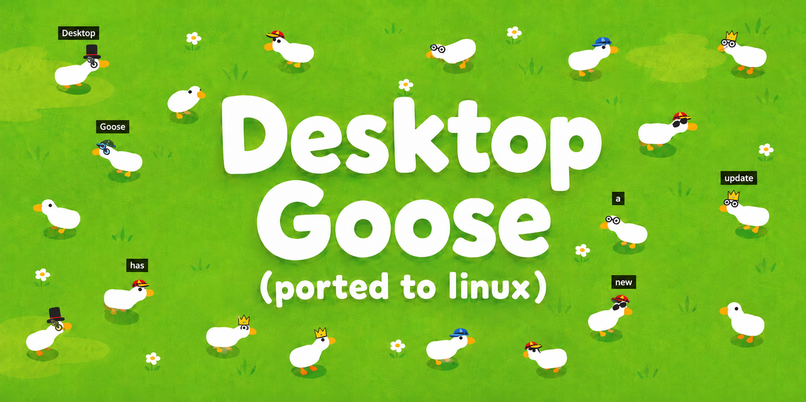
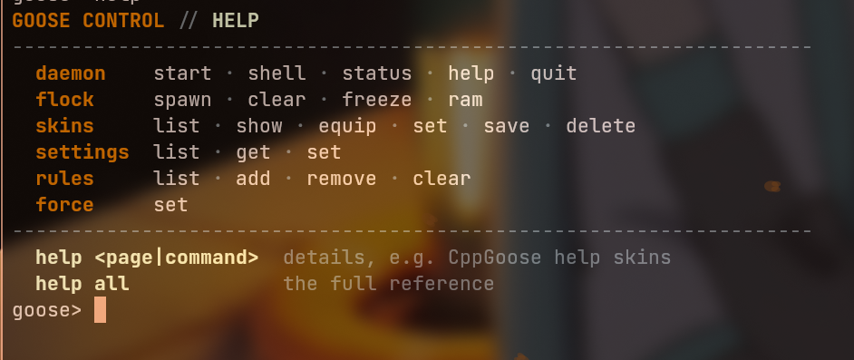

<div align="center">



<br>

[![C++ 17][Badge Cpp]][Build]
[![Wayland and X11][Badge Platforms]][Repo]
[![GitHub issues][Badge Issues]][Issues]
[![GitHub pull requests][Badge Pull Requests]][Pull Requests]
[![Last commit][Badge Last Commit]][Commits]

<br>

A Linux port of Desktop Goose with transparent overlays, multiple geese, cursor
chasing, cosmetics, pickup physics, and an interactive terminal.

<br>

---

**[<kbd> <br> Install <br> </kbd>][Build]**  **[<kbd> <br> Quick start <br> </kbd>][Quick Start]**  **[<kbd> <br> Commands <br> </kbd>][Commands]**  **[<kbd> <br> Configure <br> </kbd>][Configure]**  **[<kbd> <br> Contribute <br> </kbd>][Contribute]**

---

<sub>Version 0.31</sub>

</div>

## Features

- Transparent, click-through overlays on every detected monitor
- Multiple named geese with skins, hats, glasses, and saved looks
- Cursor chase and snatch on Hyprland and protocol-capable niri
- Window dragging and yeeting on Hyprland and niri floating windows, plus goose-vs-goose yeeting
- Pickup physics: grab a goose, stretch it, and fling it across the desktop
- Memes, notes, honks, fading footprints, and Perlin-generated personalities
- Interactive shell with history, inline hints, and TAB completion

## Preview

<div align="center">



<sub>The interactive shell keeps every command visible without filling the terminal.</sub>

</div>

## Install

CppGoose requires CMake 3.17 or newer, a C++17 compiler, Ninja, Git,
`pkg-config`, GTK4, `gtk4-layer-shell`, SDL2, SDL2_mixer, GDK Pixbuf, Wayland
client libraries, `wayland-protocols` with ext-image-copy-capture XML, X11, and XTest.

<details>
<summary><b>Arch Linux</b></summary>

```bash
sudo pacman -S cmake ninja git gtk4 gtk4-layer-shell sdl2 sdl2_mixer \
  gdk-pixbuf2 wayland wayland-protocols xorg-server-devel libxtst
```

</details>

<details>
<summary><b>Fedora</b></summary>

```bash
sudo dnf install cmake ninja-build git gtk4-devel gtk4-layer-shell-devel \
  SDL2-devel SDL2_mixer-devel gdk-pixbuf2-devel wayland-devel \
  wayland-protocols-devel libX11-devel libXtst-devel
```

</details>

<details>
<summary><b>Ubuntu 24.04 or newer</b></summary>

```bash
sudo apt install cmake ninja-build git libgtk-4-dev libgtk4-layer-shell-dev \
  libsdl2-dev libsdl2-mixer-dev libgdk-pixbuf-2.0-dev libwayland-dev \
  wayland-protocols libx11-dev libxtst-dev
```

If your repository does not provide `gtk4-layer-shell`, build it from
[wmww/gtk4-layer-shell](https://github.com/wmww/gtk4-layer-shell).

</details>

Build, test, and install system-wide:

```bash
git clone https://github.com/jeffthepineapple/desktop-goose-linux-port.git
cd desktop-goose-linux-port
cmake -S . -B build -G Ninja -DCMAKE_BUILD_TYPE=Release -DBUILD_TESTING=ON
cmake --build build
ctest --test-dir build --output-on-failure
sudo cmake --install build
```

The default prefix installs `CppGoose` to `/usr/local/bin` and the assets to
`/usr/local/share/CppGoose/Assets`. With flakes enabled, `nix run .` does the
same without a system install.

## Quick start

```bash
CppGoose spawn "Pip"  # start the daemon with one named goose
CppGoose spawn Sam     # add another goose when the daemon is running
CppGoose status        # inspect the flock
CppGoose shell         # open the interactive terminal
CppGoose quit          # remove the geese and stop the daemon
```

Running `CppGoose` starts the daemon when it is stopped, or opens the shell when
it is already running. Use `--foreground` after `spawn` for live logs.

## Commands

| Command | Purpose |
|---|---|
| `CppGoose spawn [name]` | Start the daemon with a goose, or add another |
| `CppGoose status` | Show geese, state, traits, and runtime settings |
| `CppGoose skins …` | List, equip, save, and edit cosmetic looks |
| `CppGoose settings …` | List, read, and persist configuration values |
| `CppGoose rules …` | Schedule behaviors such as wander, meme, note, chase, drag, or yeet |
| `CppGoose force set <id> …` | Interrupt one goose with a specific behavior |
| `CppGoose freeze` / `ram` | Pause behavior updates, or inspect memory use |
| `CppGoose help all` | Print the full command reference |

`CppGoose help <page-or-command>` opens a single section. On Hyprland and niri,
`drag` and `yeet` carry a captured window behind the goose and restore it afterwards;
`force set <id> yeet-goose` throws one goose at another.

## Configuration

Settings live in `$XDG_CONFIG_HOME/desktop-goose` (falling back to
`$HOME/.config/desktop-goose`) and saved looks use the same location.

```bash
CppGoose settings                    # list every key and default
CppGoose settings set walk_speed 220
```

Physics, audio, footprint, window-interaction, and multi-monitor options are all
runtime settings. Changes apply immediately and persist to disk.

## Caveats

- niri window interactions require floating windows at a monitor edge. Tiled
  windows without IPC pixel positions are skipped rather than guessed.
- niri cursor chase/snatch requires `ext-image-copy-capture` output/cursor support
  (upstream PR #4554); the tested stock niri 26.04 does not advertise it.
- niri captures use `niri msg action screenshot-window`, which also replaces the
  clipboard image. Temporary capture files are removed after decoding. During
  carry, the real window is parked on an inactive workspace and restored on
  completion or cancellation. An unnamed original workspace is temporarily named
  to keep it alive, then unnamed again.
- Focus enforcement requires Hyprland; stock GNOME lacks layer-shell support.
- Focus sends `Ctrl+W` to matched windows.
- No project-level license; bundled media may have separate terms.

### Testing niri without replacing your desktop

Run `niri` in a terminal in your current graphical session, without `--session`.
Launch Goose from a terminal inside the nested compositor so it inherits that
instance's `WAYLAND_DISPLAY` and `NIRI_SOCKET`. The niri backend takes priority
over an inherited outer Hyprland IPC socket.

Use a floating test window touching the output edge, then run:

```bash
CppGoose force set 0 drag
CppGoose force set 0 yeet
CppGoose force set 0 chase
```

Chase is unavailable when the compositor does not advertise the capture protocol.
Nested testing covers overlay rendering, capture, IPC restoration, and cursor
events; physical multi-monitor/GPU behavior still needs a real session.


## Contributing

Keep behavior and services in focused source files, put shared runtime state in
`src/world.cpp`, and run `cmake --build build` plus
`ctest --test-dir build --output-on-failure` before opening a pull request. Use
[GitHub Issues][Issues] for bugs and [Pull Requests] for code changes.

<!----------------------------------------------------------------------------->

[Build]: #install
[Quick Start]: #quick-start
[Commands]: #commands
[Configure]: #configuration
[Contribute]: #contributing

[Repo]: https://github.com/jeffthepineapple/desktop-goose-linux-port

[Issues]: https://github.com/jeffthepineapple/desktop-goose-linux-port/issues
[Pull Requests]: https://github.com/jeffthepineapple/desktop-goose-linux-port/pulls
[Commits]: https://github.com/jeffthepineapple/desktop-goose-linux-port/commits/main

[Badge Cpp]: https://img.shields.io/badge/C%2B%2B-17-00599C?logo=cplusplus&logoColor=white
[Badge Platforms]: https://img.shields.io/badge/display-Wayland%20%7C%20X11-8dd7bf
[Badge Issues]: https://img.shields.io/github/issues/jeffthepineapple/desktop-goose-linux-port
[Badge Pull Requests]: https://img.shields.io/github/issues-pr/jeffthepineapple/desktop-goose-linux-port
[Badge Last Commit]: https://img.shields.io/github/last-commit/jeffthepineapple/desktop-goose-linux-port
